# Confluent Cloud Setup

This guide connects a self-managed Kafka Connect worker to Confluent Cloud. Connector 3.x uses a Java 17+ worker and targets Kafka Connect 4.2.2; Confluent Platform 8.2.5 is the pinned worker distribution. Confluent Cloud manages the brokers independently. For an existing connector, follow the [migration guide](migration-2-to-3.md) without recreating its name or offset state.

## Prerequisites

- Bash shell
    - Will not work in Cloud Shell or WSL1
- Java 17+; Java 21 is recommended ([download](https://learn.microsoft.com/java/azure/jdk/)).
- Maven ([download](https://maven.apache.org/download.cgi))
- An existing Docker daemon with Linux containers for Testcontainers integration tests; a locally installed worker can run without Docker.
- CosmosDB [Setting up an Azure Cosmos DB Instance](https://github.com/Azure/azure-sdk-for-java/blob/main/sdk/cosmos/azure-cosmos-kafka-connect/docs/CosmosDB_Setup.md)

## Setup

### Create Confluent Cloud Account and Setup Cluster
Go to [create account](https://www.confluent.io/get-started/) and fill out the appropriate fields.

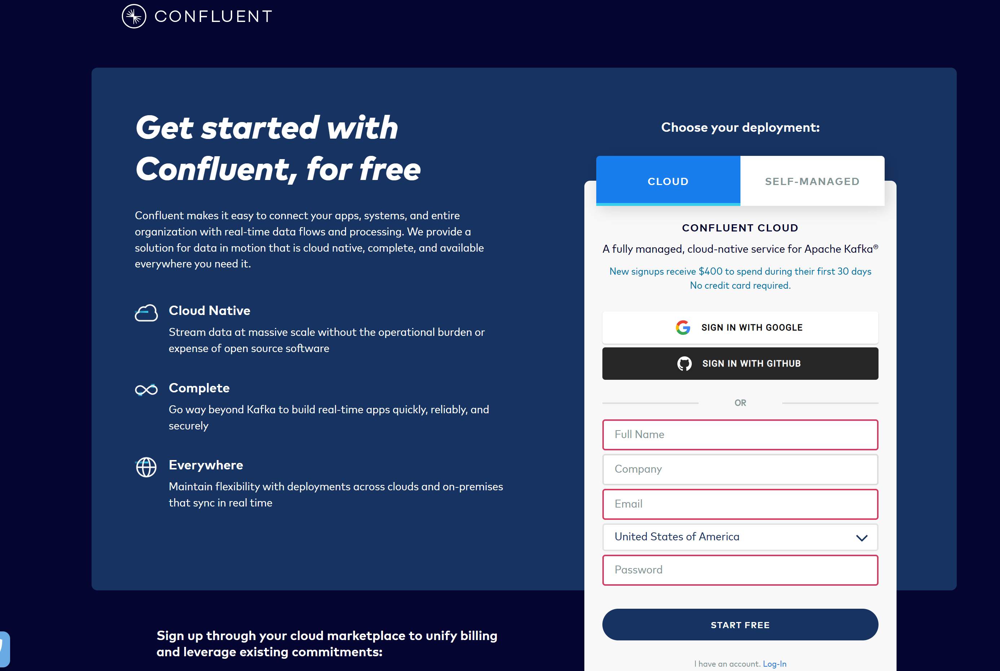

---

Select environments. 

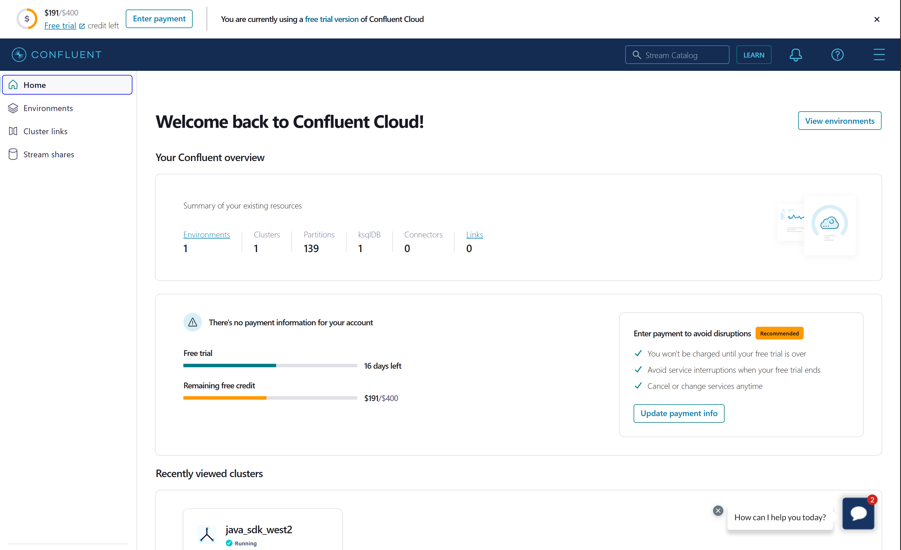

---

Select default which is an environment automatically setup by confluent. 

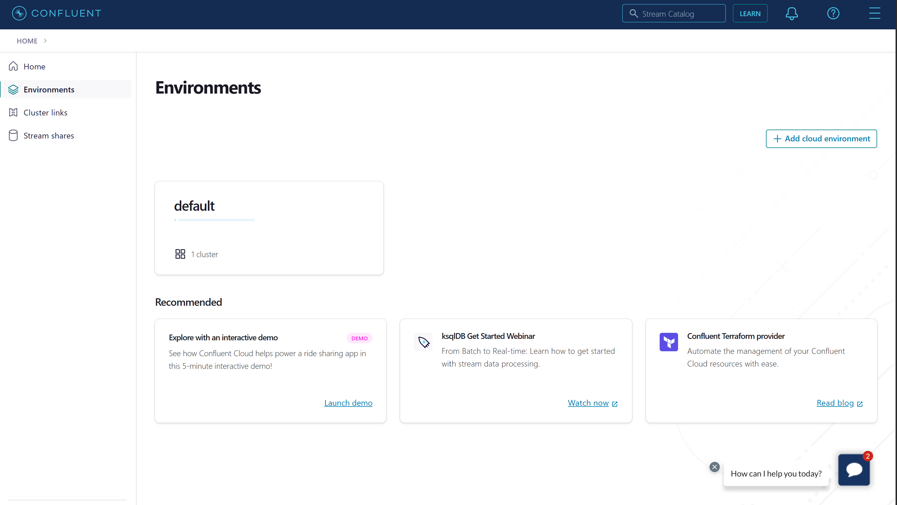

---

- Select add cluster. 

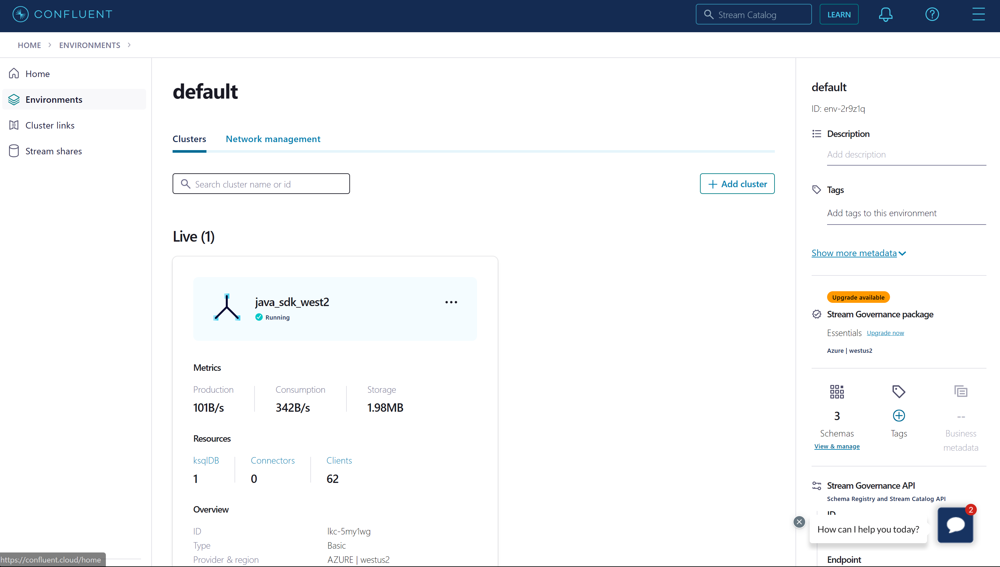

---

- Select Azure create the cluster and choose the same region as the Cosmos DB instance you created.

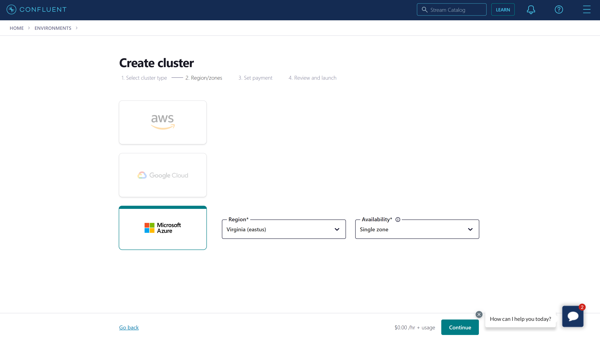

---

- Name the cluster, and then select launch cluster.

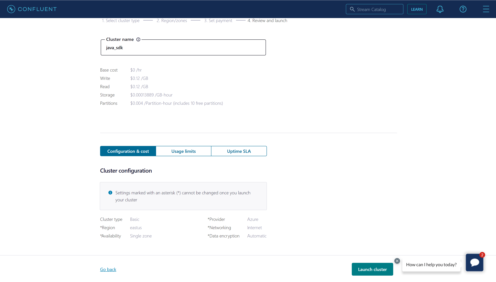


### Update Configurations
- Create a Kafka cluster API key with the permissions required by the worker and connector. Generate client configuration using CLI and Tools; a separate query-engine cluster is not required. 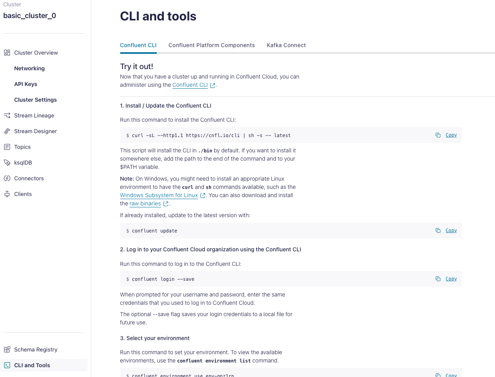
- The `BOOTSTRAP_SERVERS` endpoint can be found in the cluster under cluster settings and end endpoints. Or generate client config using the CLI and Tools. 
- The schema registry key and secret can be found on the bottom of the right panel inside the confluent environment under credentials.
- The schema registry url can be found on the bottom of the right panel inside the confluent environment under Endpoint.
  
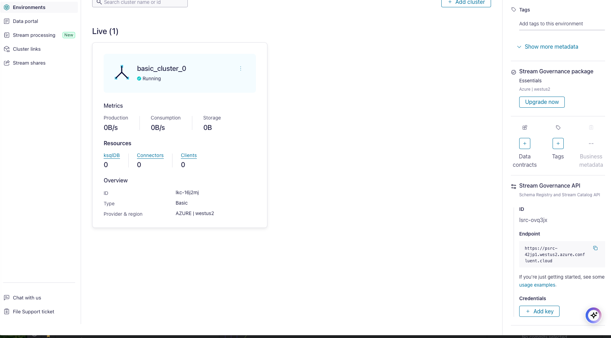
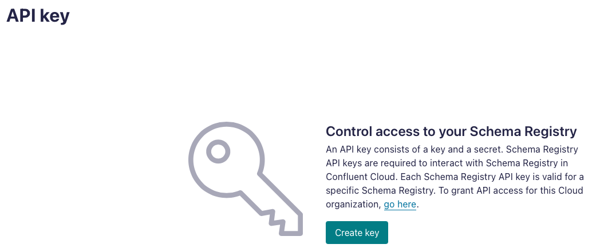

### Run Integration Tests
To run the integration tests against a confluent cloud cluster, create ~/kafka-cosmos-local.properties with the following content:
```
ACCOUNT_HOST=[emulator or Cosmos account HTTPS endpoint]
ACCOUNT_KEY=[emulator masterKey or your cosmos masterKey]
ACCOUNT_TENANT_ID=[update if AAD auth is required in the integration tests]
ACCOUNT_AAD_CLIENT_ID=[update if AAD auth is required in the integration tests]
ACCOUNT_AAD_CLIENT_SECRET=[update is AAD auth is required in the integration tests]
SASL_JAAS=[credential configured on the confluent cloud cluster]
BOOTSTRAP_SERVER=[bootstrap server endpoint of the confluent cloud cluster]
SCHEMA_REGISTRY_URL=[schema registry url of the cloud cluster]
SCHEMA_REGISTRY_KEY=[schema registry key of the cloud cluster]
SCHEMA_REGISTRY_SECRET=[schema registry secret of the cloud cluster]
CONNECT_CONFIG_STORAGE_REPLICATION_FACTOR=3
CONNECT_OFFSET_STORAGE_REPLICATION_FACTOR=3
CONNECT_STATUS_STORAGE_REPLICATION_FACTOR=3
```
Integration tests have an ITest suffix and use Failsafe; `mvn test` alone does not run them. From the repository root, use the following command after [creating required topics](#create-topic-in-confluent-cloud-ui). Run on host JDK 17 and 21; the stock 8.2 worker container uses Java 21 in both cases.
```bash
mvn -f sdk/cosmos/azure-cosmos-kafka-connect/pom.xml -Pbuild-kafka,kafka-integration clean verify
```

### Run a local sink/source workload by using confluent platform locally
- Follow [Install Confluent Platform using ZIP and TAR](https://docs.confluent.io/platform/8.2/installation/installing_cp/zip-tar.html) for Confluent Platform 8.2.5 with Java 17+.
- Copy src/docker/resources/sink.example.json to the above unzipped confluent folder
- Copy src/docker/resources/source.example.json to the above unzipped confluent folder
- Update the sink.example.json and source.example.json with your cosmos endpoint
- From the repository root, build the shaded Cosmos Kafka connector JAR:
```bash
mvn -f sdk/cosmos/azure-cosmos-kafka-connect/pom.xml -Pbuild-kafka clean package -DskipTests=true
```
- Copy only the shaded `azure-cosmos-kafka-connect-3*.jar` (not sources, javadoc, tests, or `original-*`) from the module's `target` into an isolated worker `plugin.path` directory. Do not leave both 2.x and 3.x JARs installed.
- ```cd unzipped confluent folder```
- Update the etc/distributed.properties file with your Confluent Cloud cluster configuration, including SASL/TLS and converter Schema Registry authentication. For an existing deployment, preserve `group.id`, internal topics, consumer identity, and metadata as described in the migration guide.
- Run ./bin/connect-distributed ./etc/distributed.properties
- Start your sink connector or source connector: ```curl -s -H "Content-Type: application/json" -X POST -d @<path-to-JSON-config-file> http://localhost:8083/connectors/ | jq .```
- Monitor the logs and check any exceptions, and also monitor the throughput and other metrics from your confluent cloud cluster

> If you want to delete your connector: ```curl -X DELETE http://localhost:8083/connectors/cosmosdb-source-connector-v2```. The connector name should match the one in your json config.

> If you want to restart your connector: ```curl -s -H "Content-Type: application/json" -X POST http://localhost:8083/connectors/cosmosdb-source-connector-v2/restart | jq .```

> Follow [Kafka Connect REST Interface for Confluent Platform](https://docs.confluent.io/platform/current/connect/references/restapi.html) to check other options.

### Create Topic in Confluent Cloud UI
For some cluster type, you will need to create the topic ahead of time. You can use the UI or through the [Confluent Cli](https://docs.confluent.io/cloud/current/client-apps/topics/manage.html#:~:text=Confluent%20CLI%20Follow%20these%20steps%20to%20create%20a,aren%E2%80%99t%20any%20topics%20created%20yet%2C%20click%20Create%20topic.) (Requires installing the Confluent Cli first). 

Inside the Cluster Overview, scroll down and select topics and partitions.

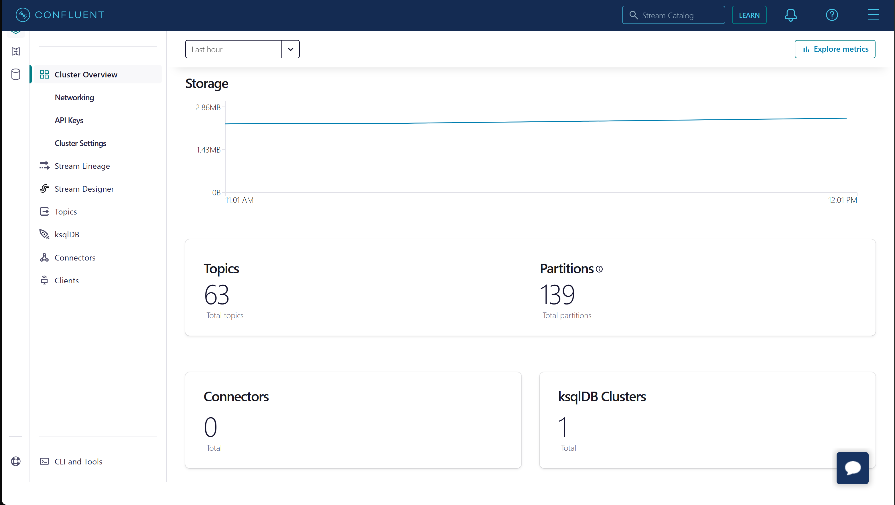

---

Select add topic.

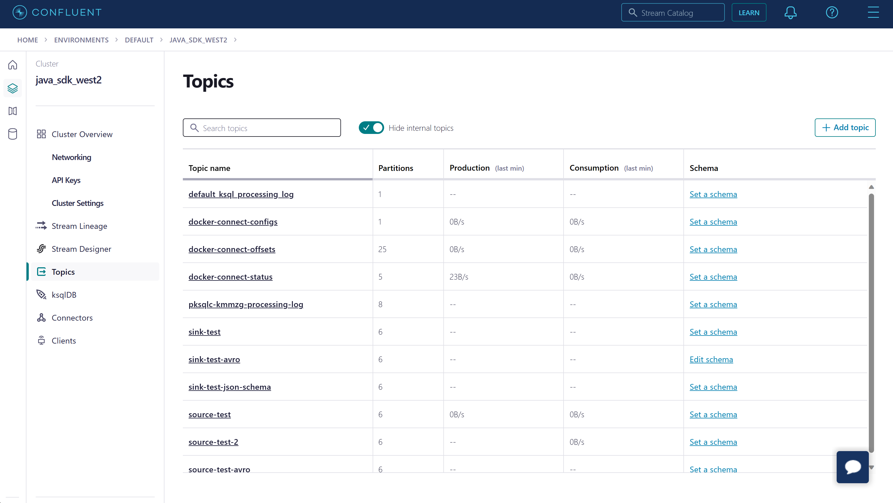

---

Name the topic and select create with defaults. Afterward, a prompt will appear about creating a schema. This can be
skipped as the tests will create the schemas.

## Resources to Improve Infrastructure
- [Docker Configurations](https://docs.confluent.io/platform/current/installation/docker/config-reference.html)
- [Configuration Options](https://docs.confluent.io/platform/current/installation/configuration/index.html)
- [Connect Confluent Platform Components to Confluent Cloud](https://docs.confluent.io/cloud/current/cp-component/index.html)
